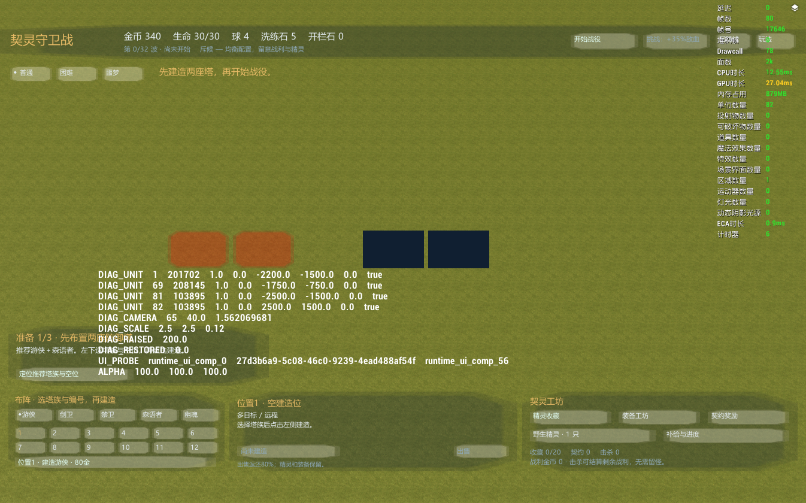
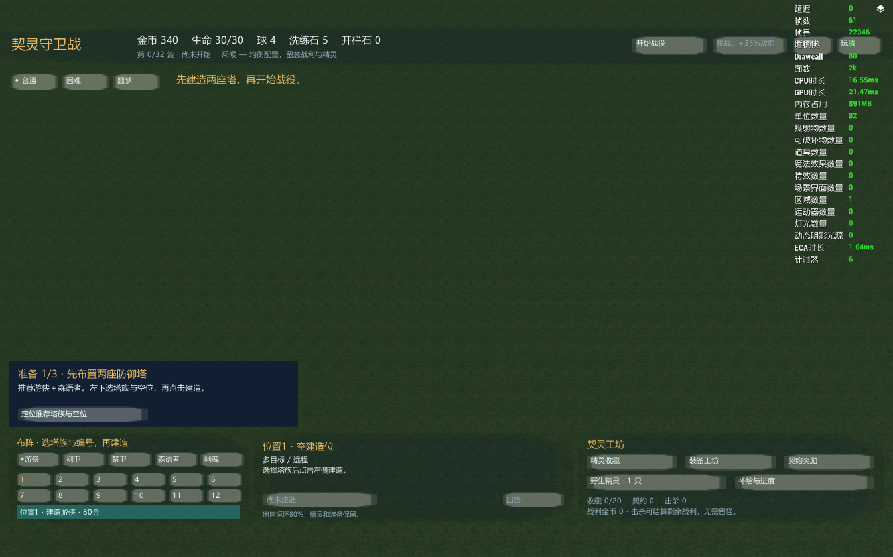

# UI 原生渲染诊断记录

时间：2026-10-24 00:53–00:57；当前 Y3 原生游戏，通过官方 y3-helper `execute_lua` 调整少量控件，随后另一次调用 `GameAPI.screenshot_func_for_lua` 截图。以下是**诊断局部截图，不是最终整图验收**；战场和其他控件保持当时诊断状态。

## 确认结果

- `GameAPI.get_ui_comp_opacity` 读回 SpiritHUD、布局根节点、探测图片均为 `100.0`，父节点透明度不是根因。
- 原图片 `131155`（白色方形按钮）自身有装饰和半透明像素，染色后仍透出草地，不能用于纯色面板。
- 原生图 `100547`、`100548` 都在当前游戏实际渲染为完整矩形；图片控件调用 `set_image(100547)` 和 `set_image_color_hex('#101f31',100)`，得到实心深蓝底。源码统一用 `100547`，没有依赖猜测 ID 或新导入资产。
- 对原生按钮四个状态设置图片 `100547` 后，再调用按钮的 `set_image_color_hex`，按钮仍呈白色；该染色调用在本次版本没有改变按钮状态皮肤。
- 有效按钮实现：四状态图片设为 `999`（空图）、状态文字清空；在按钮内先创建 `100547` 图片子控件并用 HEX 染色、关闭其操作拦截，再创建文字子控件。按钮保留本地点击事件和启用/禁用逻辑。运行时局部实测建造按钮为实心青绿色、文字清楚。

## 验证范围

`check.py ui` 通过：四状态空图/空文字、可染色且不拦点击的背景、既有操作契约、控件边界和窗口适配。截图只证明以上局部视觉结果；完整界面重启后的实际点击与整体视觉，由主会话统一部署后继续验证。
